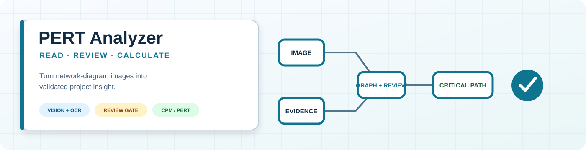
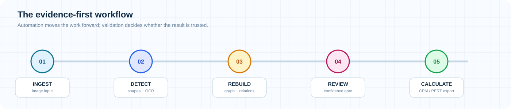
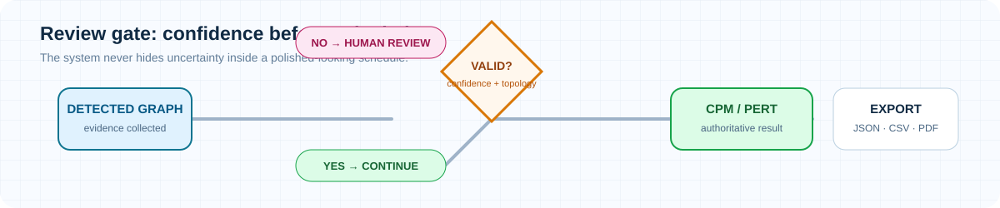

<div align="center">


# PERT & Critical Path Analyzer

### From network diagram to a validated critical path

<p><strong>Read the diagram · review the evidence · calculate with confidence</strong></p>

<a href="https://github.com/Dev-KAIDO/PERT-Critical-Path-Analyzer/actions"></a>
<a href="https://github.com/Dev-KAIDO/PERT-Critical-Path-Analyzer"></a>
<a href="https://github.com/Dev-KAIDO/PERT-Critical-Path-Analyzer/blob/main/LICENSE"></a>



[Quick start](#quick-start) · [How it works](#how-it-works) · [Review gate](#review-gate) · [Architecture](#architecture) · [Testing](#testing)

</div>

---

## What it does

PERT Analyzer turns a PNG/JPEG project network diagram into a structured graph, checks the evidence, and calculates CPM/PERT only when the graph is trustworthy.

> **الفكرة الأساسية:** إذا كانت القراءة أو العلاقة غير مؤكدة، لا يخفيها المشروع داخل نتيجة جميلة؛ يرسلها إلى المراجعة أولًا.


## How it works



1. **Read** the diagram with computer vision and OCR.
2. **Rebuild** activities, nodes, arrows, and dependencies.
3. **Review** ambiguous evidence instead of guessing.
4. **Calculate** CPM/PERT, float, critical activities, and critical paths.
5. **Export** JSON, CSV, Excel, or PDF reports.

## Review gate

The review gate is the project’s signature feature: it keeps automation fast without allowing uncertain data to become an authoritative schedule.



## Quick start

```bash
python -m venv .venv
.venv/bin/pip install -e '.[all]'
.venv/bin/pert-analyzer
.venv/bin/pert-analyzer --cli --image path/to/diagram.png
```

For OCR on Debian/Ubuntu:

```bash
sudo apt-get install tesseract-ocr tesseract-ocr-eng tesseract-ocr-ara
```

## Architecture

| Layer | Responsibility |
| --- | --- |
| `cv` + `ocr` | Image preprocessing, shapes, arrows, text, confidence |
| `pipeline` | End-to-end orchestration and review workflow |
| `graph` + `analysis` | Graph validation, CPM, PERT, float, and paths |
| `gui` | PySide6 analysis, review, results, and visualization |
| `reporting` | JSON, CSV, Excel, and PDF exports |

## Verification

```bash
QT_QPA_PLATFORM=offscreen PYTHONPATH=. python -m pytest
ruff check pert_analyzer tests
```

<details>
<summary><strong>Open UI screenshots and benchmark evidence</strong></summary>

The full repository contains the acceptance reports, benchmark artifacts, and UI screenshots under [`docs/`](docs/).

</details>

---

<div align="center">


**Read the evidence. Respect the uncertainty. Trust the validated graph.**

</div>
